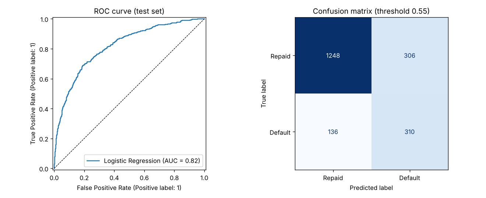
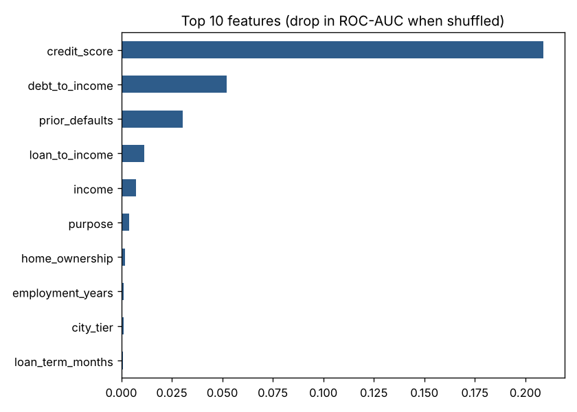

# 🏦 Loan Default Prediction

Predicts whether a loan applicant will default, so a lender can flag high-risk applications for review.
End-to-end ML workflow: synthetic data generation, feature engineering, model comparison with cross-validation,
threshold tuning, explainability and a command-line scoring tool.

**Stack:** Python · pandas · scikit-learn · matplotlib · joblib

---

## 📊 Results

**10,000 applicants, 22% default rate, 80/20 stratified train-test split.**

5-fold cross-validation on the training set:

| Model | ROC-AUC | PR-AUC | Recall | F1 |
| --- | --- | --- | --- | --- |
| **Logistic Regression** | **0.811** | **0.585** | **0.724** | **0.548** |
| Random Forest | 0.794 | 0.537 | 0.678 | 0.546 |
| Gradient Boosting | 0.789 | 0.543 | 0.677 | 0.541 |
| Decision Tree | 0.775 | 0.492 | 0.712 | 0.529 |

**Best model on the held-out test set (2,000 applicants):** ROC-AUC **0.82**, recall **0.70**
(catches 7 in 10 defaulters), precision 0.50, F1 0.58, at a tuned threshold of 0.55.



**What drives risk** (permutation importance): credit score, debt-to-income ratio, prior defaults
and loan-to-income ratio.



> Why did logistic regression win? The synthetic data's risk follows a mostly linear (logistic) pattern, so a
> simple, explainable model is enough. That is also what banks often prefer for credit decisions.

## 🔧 What the project does

| Step | Details |
| --- | --- |
| **Data** | `src/generate_data.py` creates 10,000 realistic applicants (income in INR, credit score, EMIs, loan purpose, city tier) with missing values and noise. No real customer data. |
| **Feature engineering** | Loan-to-income, EMI-to-income and a prior-default flag. |
| **Preprocessing** | scikit-learn `Pipeline` + `ColumnTransformer`: median imputation, scaling, one-hot encoding. No data leakage between folds. |
| **Class imbalance** | `class_weight="balanced"` on all models; evaluated with PR-AUC and recall, not just accuracy. |
| **Model comparison** | Logistic Regression, Decision Tree, Random Forest, Gradient Boosting with 5-fold stratified CV. |
| **Threshold tuning** | Decision threshold chosen on out-of-fold predictions to maximise F1, not the default 0.5. |
| **Explainability** | Permutation feature importance on the test set. |
| **Scoring** | `src/predict.py` scores a new applicant from the command line. |

## 🚀 Run it

```bash
git clone https://github.com/KumkumSilu/loan-default-prediction.git
cd loan-default-prediction
pip install -r requirements.txt

python -m src.generate_data     # create data/loans.csv (already included)
python -m src.train             # compare models, save model + charts + metrics
python -m src.predict --age 29 --income 480000 --credit_score 610 --loan_amount 400000 \
    --loan_term_months 36 --existing_emi 9000 --prior_defaults 1 --employment_years 2 \
    --purpose Personal --home_ownership Rent --city_tier "Tier 2"
# {'default_probability': 0.87, 'decision': 'High risk - review', 'threshold': 0.553}

pytest -q                       # tests
```

## 📁 Structure

```
├── data/loans.csv            # synthetic dataset (10,000 rows)
├── src/
│   ├── generate_data.py      # dataset generator
│   ├── train.py              # features, pipelines, CV, threshold tuning, charts
│   └── predict.py            # score one applicant
├── reports/                  # metrics.json + charts
└── tests/
```

## 🔮 Next steps

- Cost-based threshold (a missed defaulter costs more than a rejected good customer)
- SHAP explanations per applicant
- FastAPI endpoint + Docker for deployment

## 👩‍💻 Author

**Kumkum Sahoo** · AI/ML Engineer · [LinkedIn](https://linkedin.com/in/kumkum-sahoo-3738b3222)
